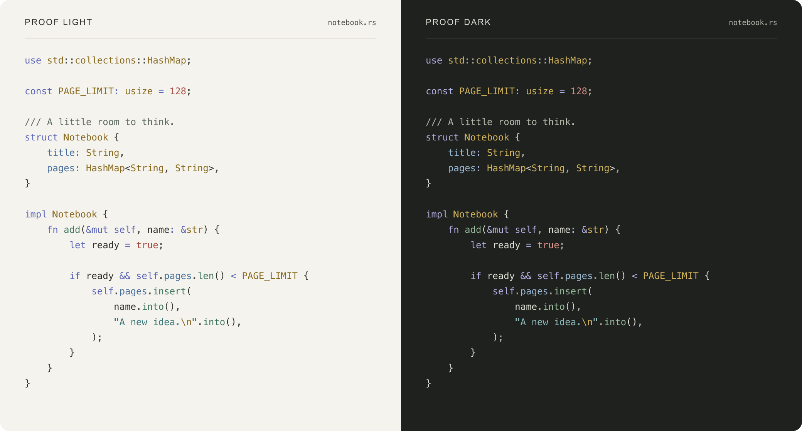

# Proof

A warm, quiet theme for [Zed](https://zed.dev), inspired by ChatGPT's Proof palette.
Light and dark, with distinct syntax colors and a matching terminal.



## Install

```sh
git clone https://github.com/eugenebokhan/zed-proof-theme.git
```

In Zed, run `zed: install dev extension` and select the cloned directory.
Then run `theme selector: toggle` and choose **Proof Light** or **Proof Dark**.

## Follow your system

Add this to your Zed settings:

```json
{
  "theme": {
    "mode": "system",
    "light": "Proof Light",
    "dark": "Proof Dark"
  }
}
```

[MIT License](LICENSE)
